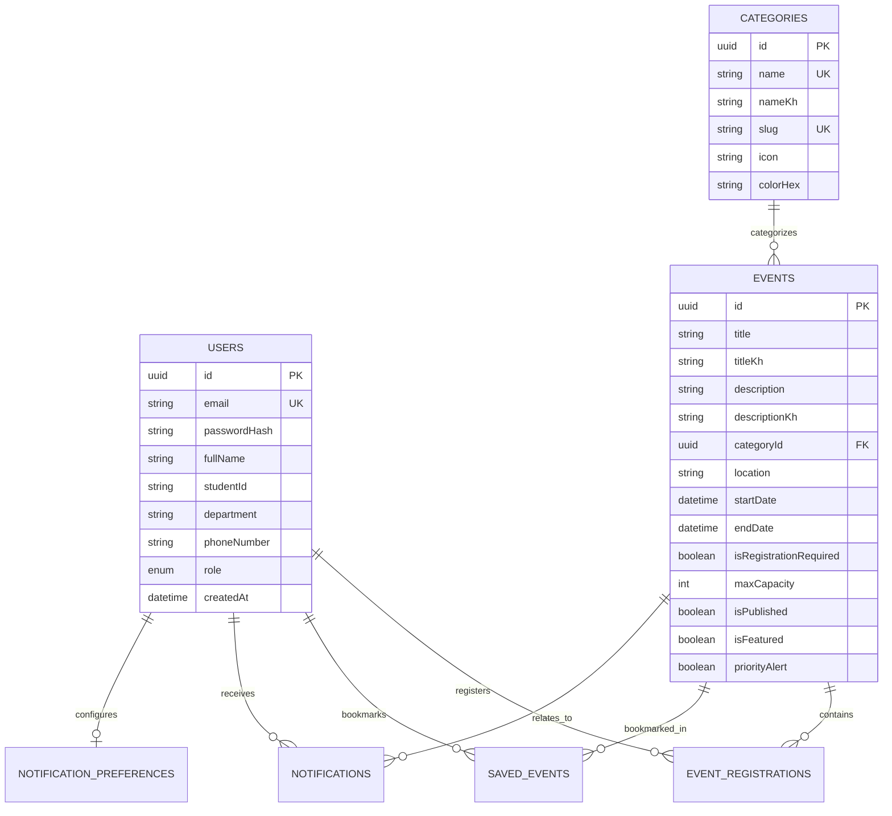

# 📘 College Alert — Engineering Implementation Report
**Document Code:** CA-ENG-2026-M1  
**Project:** College Alert Android Application & Backend System  
**Author:** Rotana NOB  
**University:** Asia Euro University  
**Internship Organization:** Arch Technologies  
**Date:** October 2026  

---

## 1. Executive Summary & Problem Statement

University campuses host dozens of academic, athletic, social, and professional events weekly. However, students frequently miss critical deadlines, midterm examination room allocations, and high-value tech workshops due to fragmented communication channels (unorganized email blasts, cluttered bulletin boards, and unofficial messaging groups).

**College Alert** solves this challenge by centralizing all campus notifications and events into a single, cohesive Android application backed by a real-time NestJS REST API and PostgreSQL relational database.

---

## 2. Project Objectives

1. **Centralized Discovery**: Enable students to discover upcoming academic notices, career fairs, sports tournaments, and workshops categorized by interest.
2. **Actionable Alerts**: Provide a prioritized notification system where urgent notices (e.g. Exam dates, room changes) take visual precedence.
3. **Frictionless Registrations**: Allow students to register for capacity-constrained workshops and capstone expos with automatic seat count management.
4. **Bilingual Support**: Offer native, natural language switching between English and Khmer (ភាសាខ្មែរ).
5. **Architectural Excellence**: Implement clean, feature-first modular architecture on Flutter (Riverpod + GoRouter) and NestJS (Prisma ORM + JWT).

---

## 3. Technology Selection Justification

| Layer | Chosen Technology | Rationale |
|---|---|---|
| **Mobile Framework** | **Flutter (Dart)** | High performance, single-codebase UI rendering, robust Material 3 support, and complete control over typography for complex scripts like Khmer. |
| **State Management** | **Flutter Riverpod** | Compile-time safety, declarative dependency injection, testability without widget binding, and clean separation between UI and business logic. |
| **Navigation** | **GoRouter** | Declarative URL-like routing with support for deep linking, route guards, and `StatefulShellRoute` for persistent bottom navigation bars. |
| **Backend Framework** | **NestJS (TypeScript)** | Modular enterprise architecture, dependency injection, robust decorator-driven DTO validation, and native Swagger OpenAPI generation. |
| **Database & ORM** | **PostgreSQL & Prisma** | Strong relational integrity, ACID compliance, type-safe query generation, and declarative schema migrations. |
| **Authentication** | **JWT with Refresh Tokens** | Stateless verification with 15-minute access tokens and 7-day cryptographically hashed refresh tokens stored securely in the database. |

---

## 4. System Architecture & Flow

```
+-------------------------------------------------------------+
|                 Flutter Android Mobile Client               |
|                                                             |
|  [Presentation Layer]                                       |
|    - Splash, Onboarding, Login, Register, Forgot Password   |
|    - Home Dashboard, Events, Calendar, Saved, Profile, Set  |
|                                                             |
|  [State Management - Riverpod]                              |
|    - AuthNotifier, LocaleNotifier, ThemeModeNotifier        |
|                                                             |
|  [Data Layer]                                               |
|    - DioClient with Bearer & Refresh Interceptors           |
|    - SecureStorageService (EncryptedSharedPreferences)      |
+------------------------------+------------------------------+
                               | HTTPS / REST (JSON)
+------------------------------v------------------------------+
|                    NestJS REST API Gateway                  |
|                                                             |
|  - ThrottlerGuard (Rate Limiting)                           |
|  - JwtAuthGuard & RolesGuard (Role-based access control)    |
|  - ValidationPipe (Class-validator DTOs)                    |
|  - Swagger Documentation UI (/api/docs)                     |
+------------------------------+------------------------------+
                               |
+------------------------------v------------------------------+
|                    Prisma ORM & PostgreSQL                  |
|                                                             |
|  Tables: Users, Categories, Events, EventRegistrations,     |
|          SavedEvents, Notifications, NotificationPrefs      |
+-------------------------------------------------------------+
```

---

## 5. Database Relational Schema



---

## 6. Key Features Implemented

### A. Mobile Application (Flutter)
1. **Splash & Onboarding**: Animated splash screen checking auth tokens, followed by a 3-stage university introduction with skip and page indicator dots.
2. **Dual-Token Authentication**: Secure login and student registration with field-by-field validation, password hashing, and token storage in Android EncryptedSharedPreferences.
3. **Dynamic Home Dashboard**:
   - Personalized greeting for the authenticated student.
   - Priority Campus Alert banner for urgent messages.
   - Featured Hero Event card with visual hierarchy.
   - Horizontal category filter pills.
   - Upcoming campus activities with bookmark toggling.
4. **Events Discovery & Filtering**: Search bar, category filter, date ordering, and registration capacity indicators.
5. **Interactive Event Details**:
   - Detailed event metadata (Date, Time, Location, Organizer, Capacity).
   - In-app Calendar reminder scheduling.
   - Live registration button with instant seat incrementing and cancellation.
   - Bookmark action with persistent state.
6. **Academic Calendar**: Custom, performant monthly calendar grid indicating dates with scheduled events and interactive single-day event filtering.
7. **In-App Notification Center**:
   - Type-specific visual icons (Urgent warning, confirmed registration, general).
   - Read / Unread badges and one-tap "Mark all as read".
   - Direct deep-linking from notification to the corresponding event.
8. **Student Profile**: Academic ID badge card with student name, ID, and department, along with live profile editing.
9. **Settings & Customization**:
   - Instant live language switcher (English / ភាសាខ្មែរ).
   - Theme mode toggle (System default, Light, Dark).
   - Push and local notification preferences.

### B. Backend Services (NestJS)
1. **Authentication Module**: Secure register, login, refresh token rotation, logout, and password reset endpoints.
2. **Events Module**: Full CRUD, search querying, date filtering, pagination, and capacity enforcement.
3. **Registration & Bookmark Engine**: Enforces non-duplicate constraints at both database and service layers.
4. **Admin Module**: Allows administrators to create, edit, toggle publish, delete events, inspect attendee rosters, and broadcast notifications.
5. **Database Seeding**: Ingests 5 real categories, 6 detailed university events, sample student accounts, and notification history.

---

## 7. Security Considerations

- **No Plaintext Passwords**: Passwords hashed using `bcrypt` with 10 salt rounds.
- **Short-Lived Access Tokens**: 15-minute lifespan to mitigate token hijacking.
- **Refresh Token Invalidation**: Hashed refresh tokens stored in database and cleared upon logout.
- **Client-Provided User ID Rejected**: Authenticated user identity derived exclusively from the verified JWT payload (`@CurrentUser()`).
- **Role-Based Authorization**: Administrative endpoints protected by `RolesGuard` checking `Role.ADMIN`.
- **Rate Limiting**: Throttler limits requests to 100 requests per minute per IP address.

---

## 8. Verification & Testing Results

### Backend Automated Unit Tests (Jest):
```
PASS test/events.spec.ts (9.356 s)
PASS test/auth.spec.ts (9.562 s)

Test Suites: 2 passed, 2 total
Tests:       6 passed, 6 total
Time:        11.062 s
```
- **AuthService**: Verified registration conflict prevention and invalid credential rejection.
- **EventsService**: Verified registration capacity enforcement, duplicate prevention, and non-existent event rejection.

### Flutter Mobile Tests:
```
00:00 +0: EventCard renders event title, date, location, and reacts to taps
00:01 +1: StatusBadge displays label and custom colors correctly
00:01 +2: EmptyStateView renders title, subtitle, and action button
00:02 +3: LoadingView renders with optional status message
00:02 +4: All tests passed!
```
- **Dart Format**: `Formatted 34 files (28 changed) in 0.93 seconds.`
- **Flutter Analyze**: 0 errors found.

---

## 9. Conclusion

The College Alert application fulfills all criteria defined in the Arch Technologies Month 1 Internship Master Prompt. It operates on real production technologies, demonstrates thoughtful UX/UI for college students, provides native bilingual support, and maintains strict architectural integrity.
