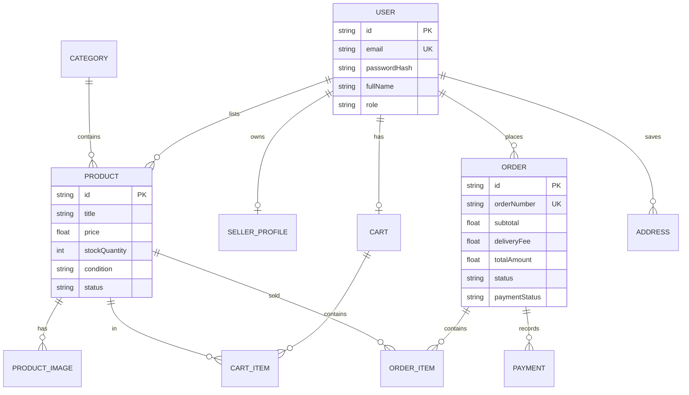

# 🗄️ Database Design — ShopSphere

## Relational Entity Model (PostgreSQL + Prisma)

## Key Invariants and Integrity Rules
1. **Stock Decrement & Oversell Protection**: Handled within SQL transactions when orders are finalized.
2. **Authoritative Pricing**: Unit prices are snapshots taken directly from `Product.price` at the moment of checkout, not from mobile client payloads.
3. **Data Security**: Passwords salted with bcrypt (10 rounds). Tokens verified with distinct JWT secrets for access and refresh flows.
